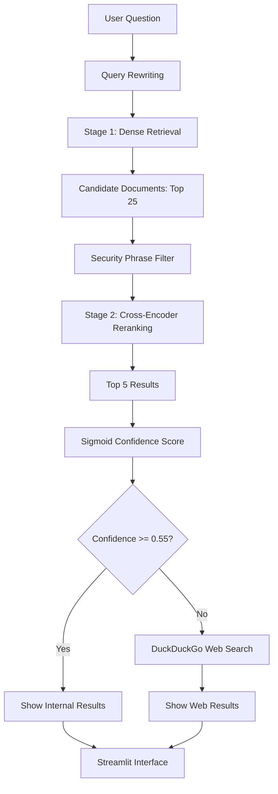

# SearchWorkbench

## Production Two-Stage RAG Pipeline & Semantic Document Search

### 1. Project Overview

SearchWorkbench is a technical document search engine that compares keyword search with semantic search.

It also includes a two-stage retrieval pipeline. The pipeline rewrites user questions, retrieves candidate documents, reranks them using a Cross-Encoder, and checks confidence before deciding whether to search the web.

### 2. Technologies

- Python 3.13
- Streamlit
- ChromaDB
- Sentence Transformers
- all-MiniLM-L6-v2
- Cross-Encoder: ms-marco-MiniLM-L-6-v2
- BM25 / rank-bm25
- DuckDuckGo Search
- pytest

### 3. Architecture and Data Flow



### 4. Chunking Methods

The project compares three document chunking methods:

1. Fixed-size chunks of 256 tokens.
2. Fixed-size chunks of 1024 tokens.
3. Structure-aware Markdown chunks.

### 5. Search Methods

**BM25 Keyword Search**

Finds documents using matching keywords.

**Dense Semantic Search**

Uses Sentence Transformers to create vector embeddings and ChromaDB to retrieve semantically similar documents.

**Two-Stage Retrieval**

- Stage 1 retrieves up to 25 candidate documents.
- Stage 2 uses a Cross-Encoder to rerank the candidates.
- The pipeline returns up to 5 top-ranked results.

**Query Rewriting**

The system includes a basic query rewriting function to help resolve references in questions when conversation context is provided.

**Confidence Gate**

The Cross-Encoder scores are converted using the sigmoid function. The current confidence threshold is 0.55.

These scores are ranking signals, not calibrated probabilities.

**Adaptive Web Fallback**

When confidence is below the threshold, the system searches DuckDuckGo for additional results.

### 6. Security

The project includes basic prompt injection phrase detection.

Retrieved documents are checked for known prompt injection phrases before reranking.

This is a basic security measure and does not guarantee protection against every prompt injection attack.

### 7. Benchmark Results

| Configuration         | Hit Rate@5 |  MRR@5 |
| --------------------- | ---------: | -----: |
| BM25 Baseline         |     1.0000 | 0.9222 |
| Dense 256             |     1.0000 | 0.8556 |
| Dense 1024            |     1.0000 | 1.0000 |
| Dense Structure-Aware |     1.0000 | 0.9111 |

All results were measured using the project's current evaluation questions and section-name matching method.

### 8. Installation and Setup

Requirements:

- Python 3.13
- Git
- PowerShell or another terminal

Clone the repository:

```bash
git clone https://github.com/melkam2490/semantic-search-benchmarker.git
cd semantic-search-benchmarker
```

Create and activate a virtual environment on Windows:

```powershell
python -m venv .venv
.\.venv\Scripts\Activate.ps1
```

Install dependencies:

```bash
pip install -r requirements.txt
```

### 9. Run the Application

Start the Streamlit application:

```powershell
python -m streamlit run .\src\app.py
```

Open the local URL displayed in your terminal.

### 10. Run Tests

Run the automated tests:

```powershell
pytest -v
```

Latest verified result:

**13 tests passed.**

The test suite includes existing project tests and security tests.

### 11. AI Code Audit

The AI-assisted development process was reviewed and corrected.

Two problems identified and fixed:

**Problem 1: Syntax Error**

Document filtering was incorrectly placed inside a function call in the search pipeline.

Fix: The filtering logic was moved after document retrieval.

**Problem 2: Security Filter Not Connected**

The prompt injection detection functions existed but were not connected to the search pipeline.

Fix: The security filter was imported and connected to the document retrieval process.

The project includes an `ai_prompt_log.md` file documenting these findings and fixes.

### 12. Project Limitations

- The current demonstration uses a small sample API document rather than a full 20–30-page technical corpus.
- The evaluation uses section-name matching rather than manually verified source spans.
- The confidence threshold is a demonstration setting and has not been calibrated against a large validation dataset.
- Prompt injection detection uses known phrases and is not a complete security solution.
- DuckDuckGo results depend on internet access.
- The current pipeline displays retrieved documents and web results; it does not yet generate complete LLM-synthesized answers.

These limitations should be considered when interpreting the results.

### 13. Conclusion

SearchWorkbench demonstrates keyword search, semantic retrieval, Cross-Encoder reranking, confidence-based routing, and web fallback.

The benchmark results show that Dense 1024 achieved the highest MRR in this sample evaluation, while BM25 also performed well on exact keyword searches.

The project demonstrates how multiple retrieval methods can work together to improve technical document search.
